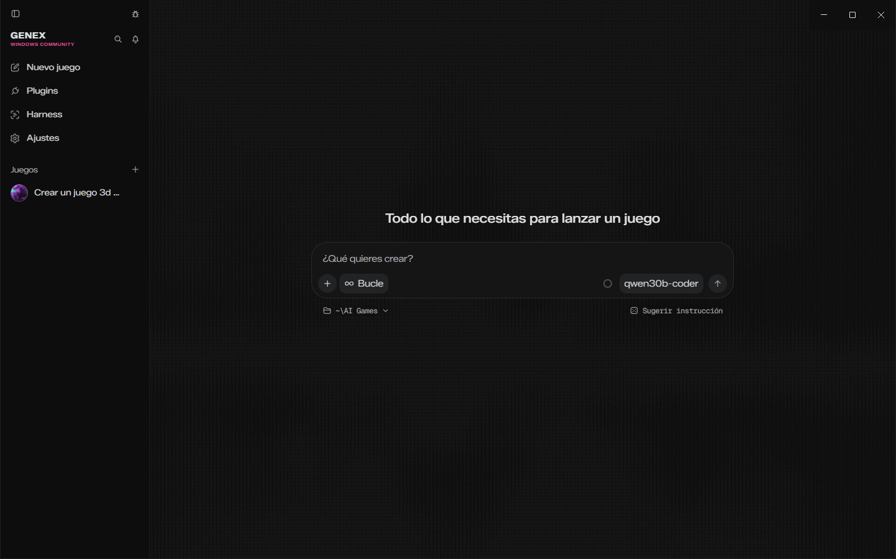
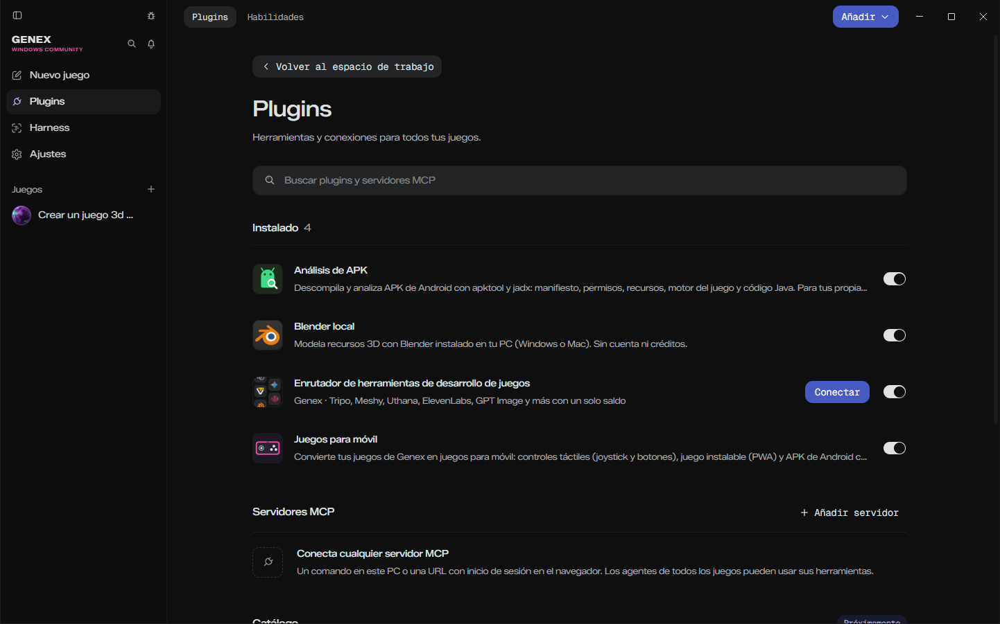
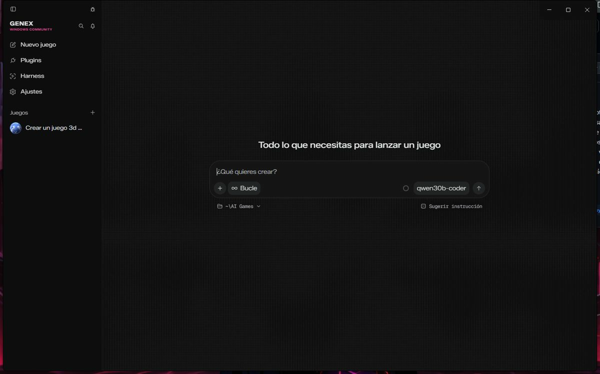
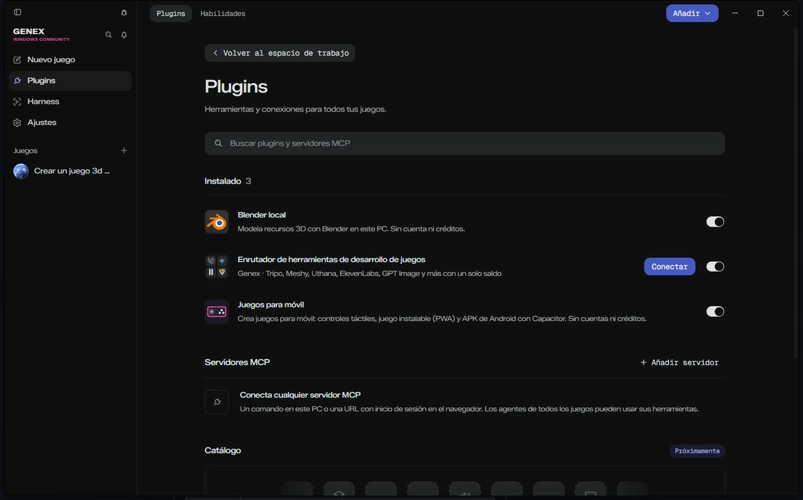
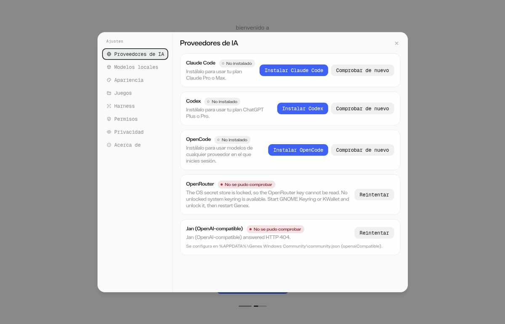
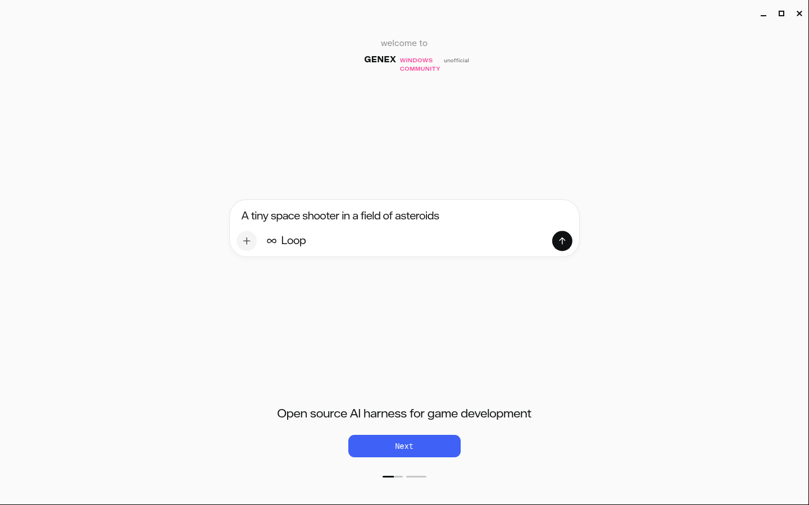
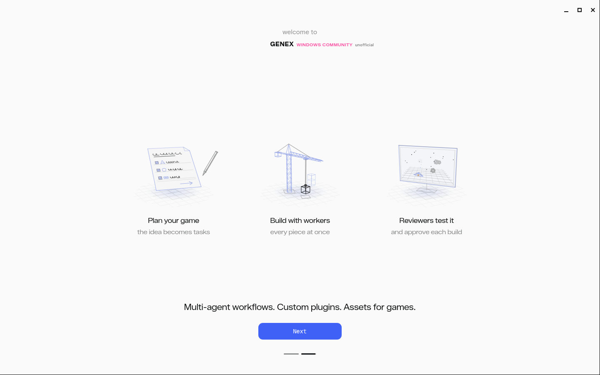

# Genex Windows Community (no oficial)

> **Fork no oficial** de [Genex](https://github.com/genex-games/genex-desktop) (licencia MIT), el estudio de escritorio donde agentes de IA crean juegos con three.js. Esta versión está pensada para **Windows** y para usar **IA local** (Jan, LM Studio, llama.cpp, Ollama…) o cualquier API compatible con OpenAI.
>
> No está hecho ni respaldado por los autores de Genex. Todo el mérito del programa original es suyo: ver [Créditos](#créditos).


*Captura real en **Windows 11** (v0.1.7, sandbox activado, interfaz en español).*

## ¿Qué cambia respecto a la versión oficial?

| | Genex oficial | Genex Windows Community |
|---|---|---|
| Arranque en Windows | Se puede quedar colgado o fallar con `srt-win acl grant ... timed out after 60000ms` o `init lock ... not acquired` | Tiempo de espera configurable (5 min por defecto), no da permisos a carpetas gigantes (pnpm, npm…), ventana de progreso, y cierra los `srt-win.exe` huérfanos que bloqueaban el arranque |
| Sandbox | Siempre activado | Activado por defecto; se puede **desactivar** con `GENEX_SANDBOX=off` (con aviso) |
| Modelos | Claude Code, Codex, Bonsai, Ollama, OpenCode, OpenRouter | Todo lo anterior **+ proveedor "OpenAI-compatible"** con presets para Jan, LM Studio, llama.cpp, vLLM, Ollama (/v1), OpenRouter, DeepSeek, OpenAI, Google Gemini y xAI Grok ([guía](docs/GOOGLE-Y-MCP.md)) |
| Actualizaciones | Auto-update desde el feed oficial | **Desactivadas** (nunca se sustituye por la versión oficial) |
| Nombre / icono | Genex | Genex Windows Community, icono propio, marcado como "unofficial" |
| Datos | `%APPDATA%\Genex` | `%APPDATA%\Genex Windows Community` (no toca tu instalación oficial) |
| Idioma | Inglés | **Español por defecto** (Ajustes › Apariencia › Idioma / Language para volver al inglés) |
| Juegos para móvil | — | **Plugin "Juegos para móvil"**: controles táctiles, juego instalable (PWA) y APK de Android con Capacitor |
| Análisis de APK | — | **Plugin "Análisis de APK"** (apktool + jadx) para tus propias apps |
| Blender local | Solo Mac | También **Windows** (`blender.exe` en Program Files, `C:`–`G:\Blender` o `GENEX_RUNTIME_BLENDER`) |
| Plugins de la comunidad | — | **Opcionales**: se desactivan o quitan en Plugins; también como zips sueltos en cada release |

## Juegos para móvil

El plugin **Juegos para móvil** viene instalado. En el chat de un juego pide, por ejemplo,
*"crea un juego de carreras para móvil"* o *"haz este juego jugable en el móvil"*. El agente:

1. Escribe en el juego `src/touch-controls.js` (joystick táctil a la izquierda, mirar arrastrando a la derecha y botones), `manifest.webmanifest` (PWA), `docs/MOBILE.md` y `docs/build-android.ps1`.
2. Conecta los controles táctiles a las mismas teclas que ya usa el juego y los dibuja en el HUD.
3. Te explica cómo probarlo: en Chrome/Edge con F12 › vista de dispositivo, en el móvil como web/PWA, o como **APK de Android**:

```powershell
# 1) En Genex: menú del juego › Exportar juego… a una carpeta, p. ej. C:\Juegos\mi-juego-web
# 2) Con Node.js y Android Studio instalados, dentro de la carpeta del juego:
powershell -ExecutionPolicy Bypass -File docs\build-android.ps1 -Export "C:\Juegos\mi-juego-web"
```

iOS necesita un Mac con Xcode.

## Instalación en Windows

1. Ve a [Releases](https://github.com/pilahito/genex-windows/releases) y descarga:
   - `GenexWindowsCommunity-Setup.exe` (instalador, se instala en `%LOCALAPPDATA%\genex-community`), **o**
   - el `.zip` portable: descomprímelo donde quieras (por ejemplo `G:\GenexCommunity`) y abre `genex-community.exe`.
2. El instalador no está firmado: Windows SmartScreen avisará. Pulsa **Más información → Ejecutar de todas formas**.
3. Requisitos: Windows 10/11 x64, [Git para Windows](https://git-scm.com/download/win) (el sandbox usa Git Bash) y Node.js si tus juegos usan npm.
4. La primera vez, Genex crea el usuario de Windows `srt-sandbox` (pide permiso de administrador una vez) y prepara permisos. Verás una ventana de progreso; puede tardar unos minutos.

### Compilarlo tú mismo

```bash
npm ci
npm run make -- --platform win32 --arch x64   # en Windows
```

El repositorio se compila solo: [`.github/workflows/build-windows.yml`](.github/workflows/build-windows.yml) genera el instalador en cada push a `main` y lo adjunta a una Release al subir una etiqueta `v*`.

## Configurar la IA

La configuración propia de este fork vive en **`%APPDATA%\Genex Windows Community\community.json`** (se crea en el primer arranque). Las variables de entorno tienen prioridad sobre el archivo.

```json
{
  "sandbox": true,
  "aclTimeoutMs": 300000,
  "sandboxSkipDirs": [],
  "openaiCompatible": {
    "preset": "jan",
    "baseUrl": "",
    "apiKey": "",
    "models": [],
    "defaultModel": "",
    "contextWindow": 32768,
    "vision": false
  }
}
```

| Campo | Variable de entorno | Para qué sirve |
|---|---|---|
| `openaiCompatible.preset` | `GENEX_OPENAI_PRESET` | `jan`, `lmstudio`, `llamacpp`, `vllm`, `ollama`, `openrouter`, `deepseek`, `openai` o `custom` |
| `openaiCompatible.baseUrl` | `GENEX_OPENAI_BASE_URL` | URL del servidor (sustituye a la del preset), normalmente acaba en `/v1` |
| `openaiCompatible.apiKey` | `GENEX_OPENAI_API_KEY` | Clave (se manda como `Authorization: Bearer`). Los servidores locales normalmente no la necesitan |
| `openaiCompatible.models` | `GENEX_OPENAI_MODELS` (separados por comas) | Lista fija de modelos. Vacía = se leen de `/models` |
| `openaiCompatible.defaultModel` | – | Modelo por defecto (si no, el primero de la lista en servidores locales) |
| `openaiCompatible.contextWindow` | – | Contexto que se asume (los servidores casi nunca lo informan) |

Después elige **"… (OpenAI-compatible)"** en el selector de modelos de Genex.

### Tabla de compatibilidad

| IA | Cómo se usa | Herramientas (tool calling) | Coste |
|---|---|---|---|
| **Jan** | preset `jan` → `http://127.0.0.1:1337/v1`. En Jan: *Settings → Local API Server → Start server*. Si pusiste API key en Jan, ponla en `apiKey` | Sí, con modelos que lo soporten (p. ej. Qwen3-Coder, Qwen2.5-Coder) | Gratis, local |
| **LM Studio** | preset `lmstudio` → `http://127.0.0.1:1234/v1` (*Developer → Start server*) | Sí | Gratis, local |
| **llama.cpp** (`llama-server`) | preset `llamacpp` → `http://127.0.0.1:8080/v1`; arranca con `--jinja` para tool calling | Sí (con `--jinja`) | Gratis, local |
| **vLLM** | preset `vllm` → `http://127.0.0.1:8000/v1`; arranca con `--enable-auto-tool-choice --tool-call-parser ...` | Sí | Gratis, local |
| **Ollama** | Proveedor **Ollama** nativo de Genex (o preset `ollama` por /v1). `--ollama-host` cambia la dirección | Sí | Gratis, local |
| **OpenRouter** | Proveedor nativo **OpenRouter** (clave en Ajustes) o preset `openrouter` | Sí | De pago por token |
| **DeepSeek** | preset `deepseek` + `apiKey` | Sí | De pago por token |
| **OpenAI API** | preset `openai` + `apiKey` | Sí | De pago por token |
| **Claude** | Proveedor **Claude Code** (necesita la CLI de Claude Code y tu suscripción) | Sí | Suscripción |
| **ChatGPT / Codex** | Proveedor **Codex** (necesita la CLI de Codex y tu suscripción) | Sí | Suscripción |

> Consejo para gráficas de 12 GB: usa modelos de programación que quepan enteros en VRAM (p. ej. `Qwen3-Coder-30B-A3B` cuantizado Q4) y temperatura baja (0.2–0.3). Cierra Wallpaper Engine y juegos mientras lo usas.
>
> Nota: el proveedor OpenAI-compatible se marca como "local" en Genex. Si lo apuntas a una API de pago (DeepSeek, OpenAI…), Genex podría usarlo también como respaldo automático; vigila tu consumo.

## Sandbox y antivirus

Genex ejecuta los agentes dentro de un sandbox (`@anthropic-ai/sandbox-runtime`, `srt-win.exe`): un usuario de Windows aparte (`srt-sandbox`) con permisos solo sobre tus juegos. Al arrancar, da permisos (ACL) a ese usuario sobre unas cuantas carpetas, incluidas las de tu `PATH`.

Cambios de este fork:

- **Tiempo de espera de ACL configurable**: 300 s por defecto (antes 60 s fijos). `GENEX_SANDBOX_ACL_TIMEOUT_MS` o `aclTimeoutMs`. Implementado como parche de `patch-package` en [`patches/`](patches/).
- **No se dan permisos a carpetas gigantes** del `PATH`: `%LOCALAPPDATA%\pnpm`, `%APPDATA%\npm`, `%LOCALAPPDATA%\npm-cache`, `%LOCALAPPDATA%\Yarn`, `scoop\apps`, `.cargo\registry`. Puedes añadir más con `GENEX_SANDBOX_SKIP_DIRS` (separadas por `;`) o `sandboxSkipDirs`.
- **Ventana de progreso** durante la preparación, en vez de quedarse "colgado" sin ventana.
- **No abras la Genex oficial a la vez**: las dos usan el mismo sandbox (`%LOCALAPPDATA%\sandbox-runtime\.acl-init.lock`). Si una copia oficial está colgada preparando permisos, esta versión falla con `init lock ... not acquired within 60000ms`. Cierra todos los `genex.exe` antes de abrirla.
- **Desactivar el sandbox**: `GENEX_SANDBOX=off` o `"sandbox": false`. ⚠️ Los agentes podrán leer y cambiar cualquier archivo de tu usuario. Úsalo solo si confías en el modelo y el proyecto.

### Kaspersky y otros antivirus

Los antivirus revisan cada cambio de permisos y pueden hacer que la preparación tarde muchísimo. Mejor que pausar el antivirus, añade exclusiones:

1. Kaspersky → **Ajustes → Configuración de seguridad → Amenazas y exclusiones → Gestionar exclusiones → Añadir**: la carpeta de instalación (p. ej. `G:\GenexCommunity\` o `%LOCALAPPDATA%\genex-community\`), con subcarpetas.
2. **Especificar aplicaciones de confianza → Añadir**, marcando "No analizar la actividad de la aplicación":
   - `...\genex-community.exe`
   - `...\resources\app.asar.unpacked\node_modules\@anthropic-ai\sandbox-runtime\vendor\srt-win\x64\srt-win.exe`

Windows Defender: *Seguridad de Windows → Protección contra virus y amenazas → Exclusiones → Agregar exclusión → Carpeta*.

## Análisis de APK

Plugin **Análisis de APK** (incluido, opcional). Para **tus propias APK o con permiso del autor**;
solo análisis: no recompila, no firma ni quita protecciones.

1. Plugins › Análisis de APK › **Instalar herramientas (apktool + jadx)** (descarga las releases
   oficiales y verifica el SHA-256). Necesita Java 17+.
2. Copia el APK a la carpeta `apk/` del juego (o dale la ruta completa) y pide en el chat
   *"analiza este APK"*.
3. El agente lo descompila en `apk-analysis/<nombre>/` (`apktool/`, `jadx/sources/`) y te resume en
   `INFORME.md`: paquete, versión, permisos sensibles, componentes exportados, motor (Unity, Godot,
   Flutter, web…) y librerías nativas. Puedes pedirle que busque textos en el código.

## Plugins opcionales

Los plugins de la comunidad (Juegos para móvil, Análisis de APK) vienen incluidos pero se pueden
**desactivar o quitar** en Plugins. Cada release publica además `genex-plugin-mobile-vX.zip` y
`genex-plugin-apk-vX.zip` para cargarlos en otra instalación de Genex (Plugins › Añadir › desde una
carpeta local). Para compilar la app sin ellos: `GENEX_BUNDLE_COMMUNITY_PLUGINS=0 npm run make`.

## Capturas

**Windows 11, v0.1.7** (capturas reales, sandbox activado):

| | |
|---|---|
|  |  |

**Windows 11, v0.1.6** (capturas reales, sandbox activado):

| | |
|---|---|
|  |  |

**Ajustes → Proveedores de IA** con la tarjeta de Jan (OpenAI-compatible) (Linux, sin Jan arrancado):



**Linux** (capturas reales, Xvfb, sin sandbox):

| | |
|---|---|
|  |  |


## Desarrollo

```bash
npm ci            # aplica el parche de sandbox-runtime (postinstall)
npm run typecheck
npm run lint
node --test tests/conformance/community.test.ts tests/conformance/community-windows.test.ts
npm start
```

Archivos propios del fork: `src/main/community.ts`, `src/renderer/i18n/` (español), `src/main/windows-srt.ts`, `src/plugins/mobile/` (Juegos para móvil), `src/plugins/apk/` (Análisis de APK), `scripts/pack-community-plugins.mjs`, `src/substrate/engines/openai-compatible.ts`, `tests/conformance/community.test.ts`, `patches/`, `.github/workflows/build-windows.yml`, `NOTICE`. Los workflows originales están desactivados en `.github/upstream-workflows/`. El README original está en [README.upstream.md](README.upstream.md).

## Créditos

- **Genex** © 2026 genex.games y colaboradores, licencia MIT — <https://github.com/genex-games/genex-desktop>. Este fork mantiene su [LICENSE](LICENSE) sin cambios; ver [NOTICE](NOTICE) y [THIRD-PARTY-NOTICES.md](THIRD-PARTY-NOTICES.md).
- `@anthropic-ai/sandbox-runtime`, pi-ai, Electron, three.js y el resto de dependencias, bajo sus licencias.
- Fork mantenido por [pilahito](https://github.com/pilahito).

---

## English summary

**Genex Windows Community** is an *unofficial* fork of [Genex](https://github.com/genex-games/genex-desktop) (MIT), the desktop AI game studio, focused on Windows and local models. It is not affiliated with or endorsed by genex-games.

- **Windows startup fixes:** configurable srt-win ACL timeout (default 300 s, `GENEX_SANDBOX_ACL_TIMEOUT_MS`, via a patch-package patch), huge package-manager folders on PATH (pnpm, npm, Yarn…) are no longer granted recursively (`GENEX_SANDBOX_SKIP_DIRS` adds more), a progress window during sandbox setup, and `GENEX_SANDBOX=off` to disable the sandbox (with a warning).
- **OpenAI-compatible provider** with presets for Jan, LM Studio, llama.cpp, vLLM, Ollama, OpenRouter, DeepSeek and OpenAI, configured in `%APPDATA%\Genex Windows Community\community.json` or `GENEX_OPENAI_*` env vars. Tool calling uses the standard OpenAI `tools`/`tool_calls` API.
- **Rebranded** (own name, icon and data folder), auto-update disabled, MIT license and original copyright kept, NOTICE added.
- **CI:** `.github/workflows/build-windows.yml` builds the Windows installer and portable zip, and attaches them to a release for `v*` tags.
- **v0.1.7:** ends orphaned `srt-win.exe` helpers that blocked startup, Local Blender works on Windows, optional "Análisis de APK" plugin (apktool + jadx, analysis only, for your own apps), improved "Juegos para móvil", Gemini and xAI presets. Community plugins can be disabled/removed and ship as separate zips.
- Screenshots are real: Windows 11 (sandbox on) and Linux (Xvfb).
